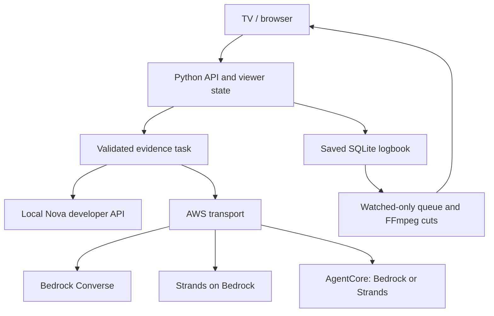

# Implemented AWS integrations

The default remains local. AWS mode is opt-in through `PREVIOUSLY_RUN_MODE=aws`. No resource is deployed or job submitted on server startup.

| Integration | Implemented files | Purpose / when used |
|---|---|---|
| Amazon Bedrock + Nova | `backend/aws_ai.py` | Converse with timestamped transcript text, binary sampled-frame images and the existing JSON evidence schemas. |
| Strands SDK | `backend/aws_ai.py::schema_model`, `AWSAI._strands` | Optional/default AWS engine. Fresh agent per task, Pydantic result model, bounded turns, no cross-viewer conversational state. |
| Bedrock AgentCore Runtime | `integrations/aws/agentcore_app.py`, `Dockerfile.agentcore`, `runtime.example.json` | Optional authenticated remote inference execution. Laptop invokes it via boto3; no SQLite/video-serving workload moves into runtime. |
| Amazon S3 | `tools/aws_assets.py` | Explicit private snapshot transfer of original media, transcripts, previews and shared catalog. SHA-256 manifest, SQLite backup, exact bytes, no viewer state. |
| SageMaker Processing | `tools/submit_aws_processing.py`, `integrations/aws/sagemaker_worker.py`, `Dockerfile.processing` | Optional one-time batch logbook creation from the S3 snapshot. Uses Nova via Bedrock/Strands; exports the derived SQLite database. No training/GPU endpoint required. |
| CloudWatch | AgentCore stdout and SageMaker Processing logs | Native managed-runtime log delivery, with `PREVIOUSLY_AUDIT_STDOUT=1`. Local servers retain their JSONL audit file. No custom CloudWatch publisher is started locally. |
| Kiro / Kiro Crew | `.kiro/steering/previously.md`, `docs/KIRO_WORKFLOW.md` | Optional development/review workflow, not runtime inference or an installed service in this release. |

## Execution and data flow

The paths under AWS transport are alternatives selected with `AWS_AI_ENGINE`, not three calls for each task. Analysis uses timestamped frames and transcript cues in either option. Story-map characters and relationships still come from `assets/db.sqlite`; AWS does not invent a replacement graph.

The app validates types, required fields, enums, evidence references, time ranges, clip lengths and watched scope. Strands structured output helps enforce shape, but the same application checks remain authoritative. Unsupported/truncated output does not become a playable fabricated clip. Both transports use successful-response caches, bounded repairs, optional request interval, service throttling retries and complete model-response audit records. There is no automatic switch to the developer API when AWS fails.

## Preserve personalization and spoilers

The shared catalog/action logbook remains in `assets/db.sqlite`. Personal memory, watch ranges, queue and history remain in `runtime/viewers.sqlite3`. Prepared-logbook ranking and FFmpeg rendering run locally in both modes; clicking Remember does not force a new model request. A not-remember signal expands/reorders available watched context using the existing policy. For unprepared source analysis, the app sends only its supplied evidence task to the selected transport. Explicit `tools/build_logbook.py` is the full-source preparation workflow; it is not called automatically for every viewer.

S3 snapshots intentionally exclude runtime, logs, dotfiles and `assets/analysis`. AgentCore containers include neither database nor raw movies. A new UUID session per call avoids sharing a model conversation between viewers. Review-model IDs are separate for Bedrock and the Nova developer API; AWS caption review stays on the selected AWS engine.

## Configuration

| Variable | Default / meaning |
|---|---|
| `PREVIOUSLY_RUN_MODE` | `local`; accepts `local`, `aws` |
| `AWS_AI_ENGINE` | `strands`; accepts `bedrock`, `strands`, `agentcore` |
| `AWS_REGION` | `us-east-1`; `AWS_DEFAULT_REGION` also supported |
| `AWS_PROFILE` | Optional standard boto3 profile selection; omit inside AWS roles |
| `AWS_BEDROCK_MODEL_ID` | `amazon.nova-pro-v1:0`; select accessible Nova vision model/profile |
| `AWS_BEDROCK_REVIEW_MODEL_ID` | Empty = main model; separate optional caption-review model |
| `AWS_AGENTCORE_RUNTIME_ARN` | Required only for the AgentCore client |
| `AWS_AGENTCORE_QUALIFIER` | `DEFAULT` |
| `AWS_AGENTCORE_ENGINE` | Endpoint-side `strands` or `bedrock`; never nested `agentcore` |
| `AI_REQUEST_INTERVAL` | `0`; no fixed one-minute delay |
| `PREVIOUSLY_AUDIT_STDOUT` | `0` locally; `1` in managed containers |

AWS SDKs are lazy imports. Local mode retains stdlib-only Python 3.9 support. AWS requires Python 3.10+ and optional packages. No AWS authentication material is bundled in the APK or written into a model request. Cache namespaces separate engine, region, model/request content and AgentCore endpoint/qualifier. Persisted validated source logbooks are deliberately provider-independent and reusable.

## Official references

- [Bedrock Converse inference](https://docs.aws.amazon.com/bedrock/latest/userguide/conversation-inference.html)
- [Nova tool definitions and supported tool choices](https://docs.aws.amazon.com/nova/latest/userguide/tool-use-definition.html)
- [Strands Bedrock provider](https://strandsagents.com/docs/user-guide/sdk/model-providers/amazon-bedrock/)
- [Strands structured output](https://strandsagents.com/docs/user-guide/sdk/agents/structured-output/)
- [AgentCore runtime](https://docs.aws.amazon.com/bedrock-agentcore/latest/devguide/runtime-get-started-cli.html)
- [SageMaker Processing](https://docs.aws.amazon.com/sagemaker/latest/dg/processing-job.html)

These integrations are implemented and locally tested; live-account deployment, model access, regional availability and real-cloud quotas must be verified with your credentials. See [AWS_VALIDATION.md](AWS_VALIDATION.md).

## Voice chatbot extension

[VOICE_CHAT.md](VOICE_CHAT.md) documents the added Nova Q&A task, device/browser speech, optional Polly output and Transcribe/S3 audio input. Chat uses the same selected Nova transport and existing watched evidence, with viewer-owned ephemeral sessions. Speech services are optional and configured separately from the inference engine.
